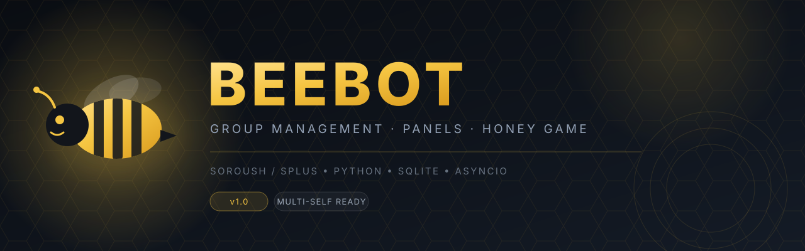

<p align="center">
  
</p>

<p align="center">
  
  
  
  
  
  
  <br>
  <a href="https://github.com/yasin115/beebot/stargazers"></a>
  <a href="https://github.com/yasin115/beebot/commits/main"></a>
</p>

<h1 align="center">🐝 BEEBOT</h1>

<p align="center">
  <b>ربات کامل مدیریت گروه برای سروش/اسپلاس</b><br>
  پنل مرکزی چند-سلف · پنل اختصاصی مالک گروه · ۲۵ قفل · فیلتر هوشمند · بن واقعی · بازی اقتصادی «کندو»
</p>

<p align="center">
  <a href="#features">ویژگی‌ها</a> ·
  <a href="#quick-start">شروع سریع</a> ·
  <a href="#panel">پنل‌ها</a> ·
  <a href="#locks">قفل‌ها</a> ·
  <a href="#commands">دستورها</a> ·
  <a href="#game">بازی کندو</a> ·
  <a href="#linkdir">لینک‌دونی</a> ·
  <a href="#faq">عیب‌یابی</a>
</p>

---

<a id="features"></a>

## ✨ چرا BEEBOT؟

| ویژگی | توضیح |
|---|---|
| 🧠 **معماری چند-سلف** | یک پنل مرکزی، چند اکانت ربات. هر سلف سشن و دیتابیس مستقل دارد و وضعیتش را هر ۱۵ ثانیه گزارش می‌دهد. |
| 🎛 **پنل داخل پیام‌رسان** | بدون هیچ وب‌سایت اضافه؛ پنل کامل با دکمه‌های شیشه‌ای داخل خود سروش. |
| 🔐 **۲۵ قفل مستقل** | از «قفل کل گروه» تا قفل گیف، استوری، کد هنگی و جوین تکراری — هر قفل سه واکنش دارد: اخطار / سکوت / بن. |
| 🚪 **بن واقعی، نه سکوت** | `view_messages=False` → اگر نشد `kick_participant` → اگر نشد سکوت. نوع بن از پنل گروه هم قابل تغییر است. |
| 🧹 **پاک‌سازی دسته‌ای** | تا ۱۰۰۰ پیام، در دسته‌های ۱۰۰تایی با فاصله — بدون flood و بدون پاک‌کردن یک‌جا. |
| 🐝 **بازی کندو** | اقتصاد کامل زنبور/گربه، کندو، زنبور طلایی، ملکه، گلستان، عسل، هدیه روزانه، قرعه‌کشی و ۱۲ دستاورد. |
| 🔗 **لینک‌دونی** | یک لینک کانال بده؛ ربات عضو کانال می‌شود و همه‌ی گروه‌های داخل پیام‌ها را یکی‌یکی عضو می‌شود. |
| 🛡 **پایداری واقعی** | واچ‌داگ اتصال، ری‌کانکت خودکار، نادیده‌گرفتن پیام‌های کهنه بعد از قطعی، WAL، بکاپ خودکار و heartbeat. |
| ⚡ **مقیاس** | تا ۸٬۰۰۰ گروه برای هر سلف، کش درون‌حافظه‌ای و نوشتن دسته‌ای روی SQLite. |

---

<a id="architecture"></a>

## 🏗 معماری

```text
                    ┌─────────────────────────────────────┐
                    │           manager.py                │
                    │   Central panel + local HTTP API    │
                    │         127.0.0.1:8788              │
                    └───────────────┬─────────────────────┘
                                    │  report  ↑   ↓  command
              ┌─────────────────────┼─────────────────────┐
              ▼                     ▼                     ▼
        ┌───────────┐         ┌───────────┐         ┌───────────┐
        │  Self #1  │         │  Self #2  │   ...   │  Self #N  │
        │ session   │         │ session   │         │ session   │
        │ SQLite DB │         │ SQLite DB │         │ SQLite DB │
        └─────┬─────┘         └─────┬─────┘         └─────┬─────┘
              │                     │                     │
              └──────────────┬──────┴─────────────────────┘
                             ▼
                   Soroush / Splus servers
```

- **manager.py** — قلب پروژه: پنل مرکزی، API محلی، ساخت/استارت/استاپ سلف‌ها، بکاپ، آپدیت کد، پیام همگانی و رجیستری سراسری گروه‌ها.
- **bot_template/** — قالب هر سلف؛ هنگام ساخت سلف به `manager_data/instances/<id>/` کپی می‌شود و `config.py` آن به‌صورت خودکار با سشن و سکرت اختصاصی بازنویسی می‌شود.
- **SQLite (WAL)** — دیتابیس هر سلف جداگانه است؛ نوشتن‌های پرتکرار (آمار پیام، اخطار) در صف دسته‌ای انجام می‌شوند تا زیر بار سنگین قفل نشود.

### جداول اصلی دیتابیس

| جدول | کار |
|---|---|
| `groups` | گروه‌های ثبت‌شده و مالک هر گروه |
| `locks` | وضعیت ۲۵ قفل + واکنش هر قفل |
| `auto_mod_settings` | اسپم/تبلیغ/فحش، سقف اخطار، سایلنت، نوع بن |
| `bans` / `mutes` / `warns` | بن، سکوت و اخطار |
| `word_filters` / `media_filters` | فیلتر کلمه و رسانه |
| `user_profiles` / `user_titles` | نام نمایشی و لقب هر گروه |
| `game_profiles` | کیف پول، کندو، عسل و دستاوردهای بازی |
| `game_settings` | روشن/خاموش بودن بازی در هر گروه |
| `group_activation` | تاریخ فعال‌سازی گروه |

---

<a id="quick-start"></a>

## 🚀 شروع سریع

### پیش‌نیازها

- Python **3.10+**
- دسترسی به سرور سروش/اسپلاس و یک اکانت برای هر سلف
- پکیج **SplusLib** (به‌صورت vendored — پایین را ببین)

> [!IMPORTANT]
> پکیج `spluslib` روی PyPI نیست و داخل این ریپو هم قرار ندارد.
> پوشه‌ی `spluslib/` را کنار `main.py` بگذار:
> `bot_template/spluslib/__init__.py` باید وجود داشته باشد، وگرنه ربات بالا نمی‌آید.

### نصب

```bash
git clone https://github.com/yasin115/beebot.git
cd beebot

python -m venv .venv
source .venv/bin/activate        # Windows: .venv\Scripts\activate

pip install -r requirements.txt
```

سپس این مقادیر را داخل `config.py` و `bot_template/config.py` پر کن:

| فایل | کلید | توضیح |
|---|---|---|
| `config.py` | `CENTRAL_BOT_TOKEN` | توکن ربات مرکزی (پنل) — رباتی جدا از سلف‌ها |
| `config.py` | `OWNER_IDS` | آیدی عددی سازنده(ها) |
| `bot_template/config.py` | `SUPER_OWNER_IDS` | آیدی سازنده‌های اصلی داخل هر سلف |
| `bot_template/config.py` | `BRAND_*` | نام برند، کانال، لینک راهنما و پشتیبانی |
| `bot_template/config.py` | `MIN_GROUP_MEMBERS` | حداقل اعضای گروه؛ `0` = بدون محدودیت |

### اجرا

**حالت ۱ — پنل مرکزی (پیشنهادی):**

```bash
python manager.py
```

خروجی:

```text
Local panel API: http://127.0.0.1:8788
```

حالا در پیوی ربات مرکزی بنویس `پنل` (یا `/start`).

**حالت ۲ — تک‌ربات بدون پنل:**

```bash
cd bot_template
python run.py
```

> [!TIP]
> روی ویندوز همیشه از `run.py` / `manager_boot.py` استفاده کن؛ این دو فایل قبل از هر import، خروجی را روی UTF-8 تنظیم می‌کنند تا پیام‌های فارسی باعث `UnicodeEncodeError` نشوند.

---

<a id="panel"></a>

## 🎛 پنل‌ها

### ۱) پنل مرکزی (فقط سازنده)

در پیوی ربات مرکزی بزن: `پنل` · `/start` · `منو`

```text
🛰 BEEBOT · اتاق فرمان
╍╍╍╍╍╍╍╍╍╍╍╍╍╍╍╍╍╍╍╍╍╍
▫ سلف‌ها 3 — 🟩 2 · ⚫ 1
▫ گروه‌های تحت پوشش 1,284
▫ سلامت سیستم ✅ نرمال
╍╍╍╍╍╍╍╍╍╍╍╍╍╍╍╍╍╍╍╍╍╍
از کدوم بخش شروع کنیم؟
```

| صفحه | کار |
|---|---|
| 📡 سلف‌ها | فهرست با فیلتر وضعیت (فعال / خاموش / بی‌واکنش)، صفحه‌بندی، جزئیات هر سلف |
| 📊 آمار | خلاصه‌ی وضعیت همه‌ی سلف‌ها و گروه‌ها |
| ⚡ عملیات سریع | اجرا/توقف همه، ری‌استارت فقط سلف‌های بی‌واکنش |
| 🩺 سلامت | CPU، RAM، دیسک، آپتایم و تعداد پروسه‌های فعال |
| 👥 گروه‌ها | فهرست گروه‌های تحت پوشش هر سلف |
| 💾 بکاپ | ساخت zip از state و ارسال همین‌جا (بدون سشن و دیتابیس) |
| ⚙️ تنظیمات | اعلان خرابی سلف |
| 📢 پیام همگانی | ارسال به همه‌ی سلف‌ها با تأخیر قابل تنظیم |
| 🛠 آپدیت کد | ارسال فایل کد و جایگزینی روی یک سلف یا همه |
| 📜 لاگ زنده | آخرین خطوط لاگ هر سلف از داخل پنل |

**ساخت سلف جدید:** `➕ سلف تازه` → نام سلف → شماره تلفن → کد تایید (OTP) → سشن ذخیره می‌شود.
اگر اکانت رمز دومرحله‌ای داشته باشد، پنل رمز را هم می‌پرسد.

### ۲) پنل مالک گروه (بخش عمومی)

مالک یا ادمین گروه، لینک عضویت گروه را به پیوی ربات مرکزی می‌فرستد؛ ربات عضو می‌شود، مالک را تشخیص می‌دهد و پنل باز می‌شود:

```text
▐ 🎛 BEEBOT
▐ مرکز فرمانِ گروه
▐ ┈┈┈┈┈┈┈┈┈┈┈┈┈┈┈┈┈┈
▐ 📌 گروه: تیم فنی
▐ 🟢 وضعیت: متصل و فعال
▐ ┈┈┈┈┈┈┈┈┈┈┈┈┈┈┈┈┈┈
▐ قفل‌ها، تنظیمات و راهنما
▐ همه از همین‌جا در دسترسه 👇
```

| بخش | امکانات |
|---|---|
| 📊 داشبورد | ربات متصل، تعداد قفل‌های فعال، سقف اخطار، نوع بن |
| 🔐 قفل‌ها | ۲۵ قفل، دسته‌بندی‌شده در رسانه / متن و لینک / امنیت |
| ⚙️ تنظیمات | سقف اخطار، سایلنت، **نوع بن**، بررسی بیو، **بازی کندو** |
| 📖 راهنما | آموزش اتصال و تنظیمات |

---

<a id="locks"></a>

## 🔐 قفل‌ها

هر قفل سه واکنش دارد و از پنل یا با دستور قابل تغییر است:

```text
قفل لینک            →  اخطار (پیش‌فرض)
قفل لینک سکوت       →  سکوت
قفل لینک بن         →  بن واقعی
باز کردن لینک       →  خاموش
```

<details>
<summary><b>فهرست کامل ۲۵ قفل</b></summary>

| دسته | قفل‌ها |
|---|---|
| 📷 رسانه | عکس · ویدیو · صدا/ویس · گیف · فایل · استیکر · اموجی |
| 💬 متن و لینک | متن · لینک · فوروارد · ریپلای · آیدی · انگلیسی · کد هنگی |
| 🛡 امنیت | کل گروه · اسپم · تبلیغ · فحش · جوین تکراری · لوکیشن · نظرسنجی · پست · استوری · لایو · سرگرمی |
| 👤 بیو | لینک‌دار بودن بیوی اعضای عادی (اخطار / بن) |

</details>

**قفل کل گروه** یعنی فقط مدیران می‌توانند پیام بفرستند و پیام بقیه پاک می‌شود.

نمونه‌ی پیام قفل:

```text
╭─────────────────╮
🔒 قفل «عکس» بسته شد — عمل: بن ✅
╰─────────────────╯
🐝@//beebot_studio/
```

---

<a id="commands"></a>

## ⌨️ دستورها

### عمومی

| دستور | کار |
|---|---|
| `راهنما` | منوی راهنما (مالک / ادمین / سخنگو / فان / بازی) |
| `فعال` | روشن‌کردن ربات؛ اولین نفر مالک گروه می‌شود |
| `غیرفعال` | خاموش‌کردن ربات در همان گروه |
| `مقام` | نمایش مقام خودت در گروه |
| `لقب` · `تنظیم لقب [متن]` · `حذف لقب` | لقب مخصوص همین گروه (با ریپلای) |
| `پاکسازی [تعداد]` | حذف تا ۱۰۰۰ پیام، دسته‌های ۱۰۰تایی |
| `دوز` | بازی OX |
| `جوک` · `فال` · `فکت` · `حدیث` · `چیستان` · `داستان` … | سرگرمی |
| `استخاره` · `قیمت طلا` · `قیمت دلار` · `فونت [متن]` | ابزارهای کاربردی |

### مدیریت اعضا

| دستور | کار |
|---|---|
| `بن` / `رفع بن` / `حذف بن` | اخراج واقعی + جلوگیری از برگشت |
| `کیک` | اخراج بدون بن (با لینک می‌تواند برگردد) |
| `سکوت` / `رفع سکوت` / `حذف سکوت` | بستن دسترسی ارسال |
| `سکوت 30` | سکوت زمان‌دار (دقیقه) — خودش باز می‌شود |
| `اخطار` / `حذف اخطار` / `رفع اخطار` | مدیریت اخطار |
| `سنجاق` / `حذف سنجاق` | سنجاق‌کردن پیام |

```text
╭─────────────────╮
🚫 بن | [مشاهده]
▸ دلیل: رسیدن به ۳ اخطار
▸ دسترسی کاربر بسته شد
▸ برای بازگشت: رفع بن
╰─────────────────╯
🐝@//beebot_studio/
```

### قفل‌ها و تنظیمات

| دستور | کار |
|---|---|
| `قفل [نام]` / `باز کردن [نام]` | روشن/خاموش قفل |
| `قفل [نام] بن` / `سکوت` | تغییر واکنش قفل |
| `لیست قفل` | وضعیت همه‌ی قفل‌ها |
| `قفل بیو` / `بازکردن بیو` | بررسی لینک در بیو |
| `تنظیم اخطار [عدد]` | سقف اخطار قبل از بن |
| `حالت بن` · `حالت بن واقعی` · `حالت بن سکوت` | نوع بن |
| `محدودیت لینک [عدد]` | سقف لینک در حالت اخطار |
| `محدودیت` | خلاصه‌ی قفل‌های فعال |

### فیلترها

| دستور | کار |
|---|---|
| `فیلتر` (با ریپلای) | فیلتر کلمه/جمله + اخطار |
| `فیلتر بن` / `فیلتر سکوت` | فیلتر با واکنش شدیدتر |
| `حذف فیلتر` · `لیست فیلتر` · `پاکسازی فیلتر` | مدیریت فیلترها |
| `فیلتر رسانه` / `فیلتر رسانه بن` / `فیلتر رسانه سکوت` | فیلتر عکس، ویدیو، استیکر، فایل |
| `حذف فیلتر رسانه` · `لیست فیلتر رسانه` | مدیریت فیلتر رسانه |

### مقام‌ها و لیست‌ها

| دستور | کار |
|---|---|
| `تنظیم ویژه` / `حذف ویژه` / `لیست ویژه` / `ویژه پاک` | ادمین ربات (دسترسی محدود) |
| `تنظیم ادمین` / `حذف ادمین` / `لیست ادمین` / `ادمین پاک` | ادمین کامل |
| `تنظیم معاف` / `حذف معاف` / `لیست معاف` | معاف از قفل‌ها و فیلترها |
| `لیست مدیر` · `لیست بن` · `لیست سکوت` | گزارش‌های گروه |
| `پاکسازی لیست بن` / `پاکسازی لیست سکوت` | پاک‌کردن لیست‌ها |

### مالک گروه

| دستور | کار |
|---|---|
| `انتقال مالکیت` / `واگذاری مالکیت` | واگذاری به کاربر (ریپلای یا آیدی) |
| `اسم ربات` · `تنظیم اسم ربات [اسم]` · `حذف اسم ربات` | نام اختصاصی ربات در گروه |
| `انتخاب اسم تصادفی` + `فعال` / `غیرفعال` | نام تصادفی اعضا |
| `تغییر دستور [اصلی] [جدید]` | تغییر نام دستورها |
| `لیست تغییر دستورها` / `پاکسازی تغییر دستورها` | مدیریت تغییرها |
| `لیست مالک` | مالک ثبت‌شده‌ی گروه |

### پیوی سازنده

| دستور | کار |
|---|---|
| `پنل` / `پنل سازنده` | پنل کنترل |
| `پیام عضویت` · `تنظیم پیام عضویت [متن]` · `ریست پیام عضویت` | پیام عضویت اجباری |
| `ارسال به همه [متن]` | پیام همگانی |
| `لفت همه` / `تایید لفت همه` | خروج از همه‌ی گروه‌ها |
| `نادید گرفتن [آیدی]` / `رفع نادید گرفتن` / `لیست نادید گرفته‌ها` | بی‌پاسخ‌کردن به کاربر |
| `محروم کامل [آیدی] [دلیل]` / `رفع محروم کامل` / `لیست محروم کامل` | سکوت سراسری |
| `لینکدونی [لینک کانال]` / `وضعیت لینکدونی` / `توقف لینکدونی` | عضویت خودکار در گروه‌های یک کانال |

---

<a id="game"></a>

## 🐝 بازی «کندوی BEEBOT»

یک بازی اقتصادی سبک برای گرم‌کردن گروه: با `بیز` امتیاز زنبوری بگیر، کندو بساز، عسل برداشت کن و با `میو` امتیاز گربه‌ای جمع کن.

### هسته

| دستور | نتیجه | کول‌داون |
|---|---|---|
| `بیز` | **+۱۰۰** امتیاز زنبوری | ۳ دقیقه |
| `میو` | **+۵۰** امتیاز گربه‌ای | ۳ دقیقه |
| `کندو` | کیف پول، سطح، تولید و کول‌داون | — |
| `عسل` | برداشت عسل و تبدیل به امتیاز | — |
| `تبدیل 100` | ۱۰۰ گربه‌ای → ۱۰۰ زنبوری (۱:۱) | — |

### فروشگاه

| آیتم | قیمت | اثر |
|---|---|---|
| 🏠 کندو | ۶۰۰ 🍯 | +۲ عسل/ساعت · ظرفیت +۳۰ · جای ۳ زنبور |
| 🐝 زنبور کارگر | ۳۰۰ 🍯 | +۴ عسل/ساعت |
| 🌟 زنبور طلایی | ۱٬۵۰۰ 🍯 | +۱۰ عسل/ساعت (حداکثر ۵) |
| 🌸 گلستان | ۱٬۰۰۰ 🍯 | +۳ عسل/ساعت · ظرفیت +۱۲ |
| 👑 ملکه | ۴٬۵۰۰ 🍯 | +۲۵٪ کل تولید (حداکثر ۳) |
| 🐱 گربه‌ی نگهبان | ۳۵۰ 🐱 | −۳۰٪ سرقت خرس (حداکثر ۳) |

**فرمول تولید:**

```text
rate = (2 + 2×hives + 4×bees + 10×golden_bees + 3×gardens) × (1 + 0.25×queens)
cap  = 20 + 30×hives + 12×gardens + 5×golden_bees
```

### مکانیک‌ها

- 🔥 **استریک بیز** — اگر بعد از پایان کول‌داون (تا ۱۵ دقیقه) برگردی، استریک بالا می‌رود؛ تا **+۵۰٪** جایزه.
- 🌼 **رویداد تصادفی** — گل طلایی (+۵۰)، رقص زنبور (+۲۵)، خرس (سرقت ۱۰٪ امتیاز، مگر گربه‌ها نجاتش دهند).
- 🎁 **هدیه‌ی روزانه** — هر ۲۴ ساعت: امتیاز، عسل، زنبور رایگان یا جکپات ۵۰۰.
- 🎰 **قرعه‌کشی** — بلیت ۵۰۰ امتیازی؛ جایزه‌ها ۰ تا ۵٬۰۰۰.
- 🎖 **۱۲ دستاورد** — از «اولین بیز» تا «۱۰٬۰۰۰ امتیاز»، هر کدام با جایزه‌ی نقدی.
- 🏆 **جدول کندو** — ۱۰ نفر برتر همان گروه.

### سطح‌ها

| امتیاز کل | سطح |
|---|---|
| ۰ | 🥚 تخم |
| ۵۰۰ | 🐛 لارو |
| ۲٬۰۰۰ | 🐝 زنبور کارگر |
| ۶٬۰۰۰ | 🍯 عسل‌چین |
| ۱۵٬۰۰۰ | 🏠 کندودار |
| ۴۰٬۰۰۰ | 👑 ملکه |
| ۱۰۰٬۰۰۰ | 🌟 افسانه‌ی کندو |

### نمونه‌ی پروفایل

```text
🐝 𝗕𝗘𝗘𝗕𝗢𝗧 · کندوی تو
╭──────────────────────╮
┃ 🍯 امتیاز زنبوری: **2,600**
┃ 🐱 امتیاز گربه‌ای: **300**
┃ 🏅 سطح: 🍯 **عسل‌چین**
┃
┃ 🏠 کندو 2 · 🐝 زنبور 4 · 🌟 طلایی 1
┃ 🌸 گلستان 1 · 👑 ملکه 1
┃ 🐱 گربه‌ی نگهبان 1
┃
┃ 🍯 عسل آماده: **42.0** از 97
┃ 📈 تولید: **43.8** عسل در ساعت
┃ 🏺 کل عسل برداشت‌شده: 240
┃
┃ ⏳ بیز: آماده ✅ · میو: 2:14
╰──────────────────────╯
🐝@//beebot_studio/
```

**کنترل مدیر:** `بازی خاموش` / `بازی روشن` در گروه، یا دکمه‌ی «🎮 بازی کندو» در پنل گروه.

**بالانس:** همه‌ی اعداد بالای بخش بازی در `main.py` هستند: `GAME_BUZZ_CD`، `GAME_MEOW_CD`، `GAME_SHOP`، `GAME_LOTTERY_PRIZES` و …

---

<a id="linkdir"></a>

## 🔗 لینک‌دونی (عضویت خودکار)

یک کانال «لینک‌دونی» بساز که داخلش لینک گروه‌ها را بگذاری؛ ربات خودش همه را عضو می‌شود.

```text
لینکدونی https://splus.ir/your_channel
```

**مراحل:**

1. ربات اول عضو کانال می‌شود (لینک عمومی یا خصوصی).
2. همه‌ی پیام‌های کانال خوانده و لینک‌های گروهی استخراج می‌شوند.
3. هر لینک یکی‌یکی باز می‌شود، با فاصله‌ی **۸ تا ۱۵ ثانیه** (ضد Flood).
4. هر ۱۰ گروه یک گزارش در همان چت می‌آید.

| دستور | کار |
|---|---|
| `لینکدونی [لینک]` | شروع اسکن و عضویت |
| `وضعیت لینکدونی` | پیشرفت زنده |
| `توقف لینکدونی` | توقف بعد از عضویت فعلی |

> [!NOTE]
> این دستور فقط برای **سازنده‌ی اصلی** است. سقف هر اجرا `LINKDIR_MAX_LINKS` (پیش‌فرض ۲۰۰) است.
> اگر Flood بخورد، خودکار ۶۰ ثانیه صبر می‌کند و یک‌بار دیگر تلاش می‌کند.

---

<a id="structure"></a>

## 🗂 ساختار پروژه

```text
beebot/
├── manager.py                  # پنل مرکزی + API محلی + مدیریت سلف‌ها
├── config.py                   # تنظیمات پنل مرکزی (توکن، آیدی سازنده‌ها، پورت)
├── requirements.txt
├── README.md
├── LICENSE
├── .gitignore
├── assets/
│   └── banner.svg
└── bot_template/
    ├── main.py                 # هسته‌ی ربات: گروه، پیوی، قفل‌ها، بازی
    ├── database.py             # SQLite + کش + مهاجرت + بکاپ
    ├── config.py               # تنظیمات هر سلف (برند، سشن، پنل)
    ├── run.py                  # اجرای تک‌ربات
    ├── manager_boot.py         # لانچر سلف + پچ اتصال سروش
    ├── healthcheck.py          # بررسی سینتکس و سلامت پکیج
    ├── utils.py
    ├── fonts_api.py
    ├── speaker_api.py
    ├── group_registry_server.py
    └── spluslib/               # (vendored — باید خودت اضافه کنی)
```

---

<a id="config"></a>

## ⚙️ تنظیمات

### `config.py` (پنل مرکزی)

| کلید | پیش‌فرض | توضیح |
|---|---|---|
| `CENTRAL_BOT_TOKEN` | — | توکن ربات پنل |
| `OWNER_IDS` | — | آیدی عددی سازنده‌ها |
| `PANEL_PORT` | `8788` | پورت API محلی (فقط `127.0.0.1`) |
| `BROADCAST_DELAY` | `1.5` | تأخیر بین پیام‌های همگانی |
| `PUBLIC_JOIN_CHANNELS` | `["beebot_studio", …]` | کانال‌های عضویت اجباری پنل کاربری |
| `MAX_GROUPS_PER_SELF` | `8000` | سقف گروه هر سلف |
| `BOT_BRAND` | `beebot` | برند پروژه |

### `bot_template/config.py` (هر سلف)

| کلید | پیش‌فرض | توضیح |
|---|---|---|
| `MIN_GROUP_MEMBERS` | `0` | حداقل اعضای گروه؛ `0` = بدون محدودیت |
| `SESSION_FILE` / `DB_PATH` | `session.txt` / `group_bot.db` | سشن و دیتابیس سلف |
| `SUPER_OWNER_IDS` | — | سازنده‌های اصلی |
| `BRAND_CHANNEL_LINK` / `BRAND_HELPER_LINK` / `BRAND_SUPPORT_CONTACT` | — | لینک‌ها و پشتیبانی |
| `CONNECTION_WATCHDOG_INTERVAL_SECONDS` | `180` | فاصله‌ی چک اتصال |
| `STALE_MESSAGE_SKIP_SECONDS` | `10` | نادیده‌گرفتن پیام‌های کهنه |
| `OTP_CODE_FILE` | `otp_code.txt` | خواندن کد تایید از فایل |
| `NTFY_TOPIC` | `None` | هشدار فوری روی ntfy.sh |
| `LINKDIR_MAX_LINKS` | `200` | سقف لینک در هر اجرای لینک‌دونی |
| `LINKDIR_MIN_DELAY` / `LINKDIR_MAX_DELAY` | `8` / `15` | فاصله بین دو عضویت (ثانیه) |
| `PANEL_BOT_LINK` | `""` | لینک ربات پنل برای پیشنهاد در پیام «ادمین نیستم» |

> [!NOTE]
> مقادیر `PANEL_API_URL`، `PANEL_SECRET`، `GROUP_REGISTRY_*` و `BOT_DISPLAY_LABEL` هنگام ساخت سلف **به‌صورت خودکار** توسط `manager.py` نوشته می‌شوند؛ دستی تغییرشان نده.

---

<a id="api"></a>

## 🔌 API محلی

روی `127.0.0.1:8788` (فقط localhost):

| Method | Path | کار |
|---|---|---|
| `POST` | `/api/report` | دریافت گزارش وضعیت سلف |
| `GET` | `/api/broadcast` | تحویل دستور همگانی به سلف |
| `POST` | `/api/broadcast/ack` | تأیید اجرای دستور |
| `POST` | `/api/registry/check` | بررسی حضور ربات دیگر در گروه |
| `POST` | `/api/registry/announce` | اعلام حضور |
| `POST` | `/api/registry/leave` | اعلام خروج |
| `POST` | `/api/registry/mine` | گروه‌های یک سلف |
| `GET` | `/health` | healthcheck |

---

<a id="security"></a>

## 🔒 نکته‌ی اجرا

- پنل فقط روی `127.0.0.1` گوش می‌دهد و از بیرون در دسترس نیست.
- برای دسترسی از راه دور، از **SSH tunnel** استفاده کن:
  ```bash
  ssh -L 8788:127.0.0.1:8788 user@server
  ```
- بکاپ پنل عمداً سشن، دیتابیس و `config.py` سلف‌ها را شامل نمی‌شود.
- `manager_data/` حاوی سشن‌هاست؛ دسترسی فایل‌سیستم را محدود نگه دار.

---

<a id="deploy"></a>

## 🐧 استقرار روی سرور (systemd)

```ini
# /etc/systemd/system/beebot.service
[Unit]
Description=BEEBOT Manager
After=network-online.target
Wants=network-online.target

[Service]
Type=simple
User=beebot
WorkingDirectory=/opt/beebot
ExecStart=/opt/beebot/.venv/bin/python manager.py
Restart=always
RestartSec=5
Environment=PYTHONUNBUFFERED=1

[Install]
WantedBy=multi-user.target
```

```bash
sudo systemctl daemon-reload
sudo systemctl enable --now beebot
sudo journalctl -u beebot -f
```

> [!TIP]
> اگر سرور ترمینال تعاملی ندارد، کد تایید (OTP) را در `otp_code.txt` کنار `main.py` بنویس؛ ربات هر ۲ ثانیه چک می‌کند و بعد از استفاده پاکش می‌کند.

---

<a id="faq"></a>

## ❓ عیب‌یابی

| مشکل | علت / راه‌حل |
|---|---|
| `ModuleNotFoundError: No module named 'spluslib'` | پوشه‌ی `spluslib/` را کنار `main.py` بگذار. |
| `ModuleNotFoundError: No module named 'config'` | مطمئن شو `config.py` هم در ریشه و هم در `bot_template/` وجود دارد. |
| ربات می‌گوید «دسترسی ادمین لازمه» | ربات را در گروه ادمین کن و دسترسی حذف پیام / بن / سنجاق را روشن کن. |
| ربات بالا می‌آید ولی جواب نمی‌دهد | ربات را ادمین کن، در گروه `فعال` بزن، و مطمئن شو `قفل گروه` روشن نباشد. |
| پنل باز نمی‌شود | توکن `CENTRAL_BOT_TOKEN` را چک کن و در پیوی همان ربات `پنل` بزن. |
| `Address already in use` | `PANEL_PORT` را عوض کن (مثلاً ۸۷۸۹) و ربات را ری‌استارت کن. |
| پیام‌های فارسی روی ویندوز کرش می‌کنند | از `run.py` / `manager_boot.py` استفاده کن، نه `python main.py`. |
| دو ربات هم‌زمان در یک گروه | رجیستری سراسری فعال است؛ اگر غیرفعالش کردی، `GROUP_REGISTRY_API_URL` را برگردان. |
| `database is locked` | چند پروسه‌ی موازی روی یک دیتابیس؛ سلف تکراری را ببند و `manager.py` را ری‌استارت کن. |
| بعد از قطعی، ربات به پیام‌های قدیمی جواب می‌دهد | `STALE_MESSAGE_SKIP_SECONDS` را کم کن (پیش‌فرض ۱۰ ثانیه). |

---

<a id="roadmap"></a>

## 🗺 نقشه راه

- [x] معماری چند-سلف + پنل مرکزی
- [x] ۲۵ قفل + فیلتر کلمه و رسانه
- [x] بن واقعی / سکوت / کیک
- [x] پنل مالک گروه
- [x] بازی کندو با اقتصاد کامل
- [ ] داشبورد وب اختیاری برای پنل
- [ ] تست‌های خودکار با `pytest`
- [ ] Docker Compose
- [ ] i18n (انگلیسی / عربی)

---

<a id="contributing"></a>

## 🤝 مشارکت

1. Fork کن و یک برنچ بساز: `git checkout -b feature/my-feature`
2. تغییرات را کوچک و متمرکز نگه دار.
3. قبل از PR این‌ها را اجرا کن:
   ```bash
   pip install pyflakes
   python -m py_compile bot_template/main.py bot_template/database.py manager.py
   python -m pyflakes bot_template/main.py bot_template/database.py manager.py
   python bot_template/healthcheck.py
   ```
4. PR را با توضیح واضح باز کن.

---

<a id="disclaimer"></a>

## ⚖️ سلب مسئولیت

این پروژه یک ابزار مدیریت گروه است. مسئولیت رعایت قوانین پیام‌رسان، حریم خصوصی اعضا،
دریافت مجوز از مدیران گروه و استفاده‌ی قانونی از آن بر عهده‌ی راهبرنده است.
پروژه هیچ داده‌ای را به سرور شخص ثالث ارسال نمی‌کند؛ تمام داده‌ها روی همان سرور شما در SQLite می‌ماند.

---

<a id="license"></a>

## 📄 لایسنس

این پروژه تحت لایسنس **MIT** منتشر شده است. فایل [LICENSE](LICENSE) را ببین.

---

<p align="center">
  ساخته‌شده با ☕ و 🐝 برای مدیران گروه‌های سروش<br><br>
  <a href="https://github.com/yasin115/beebot">⭐ گیت‌هاب</a> ·
  <a href="https://splus.ir/beebot_studio">📣 کانال</a> ·
  <a href="https://splus.ir/beebot_admin">🆘 پشتیبانی</a>
</p>
